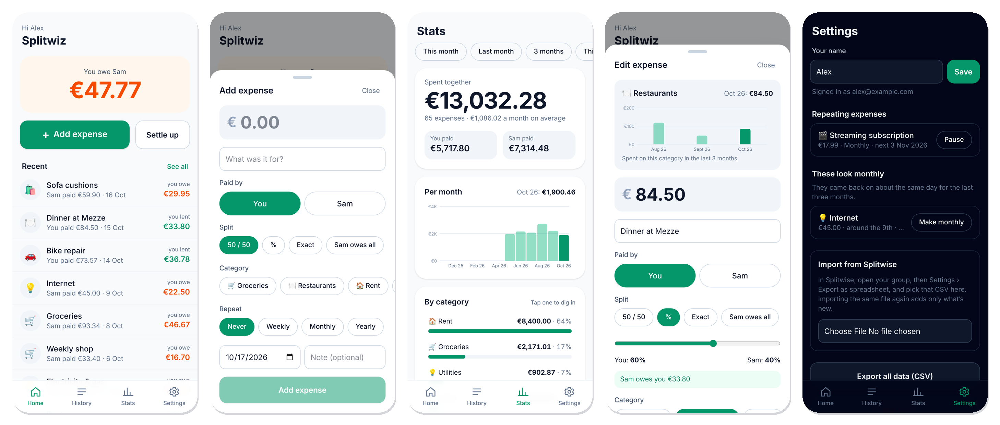
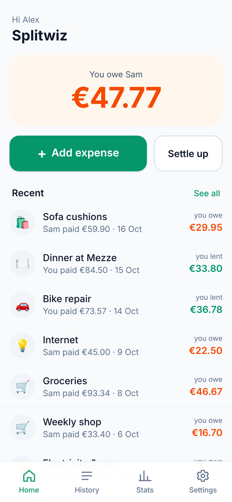
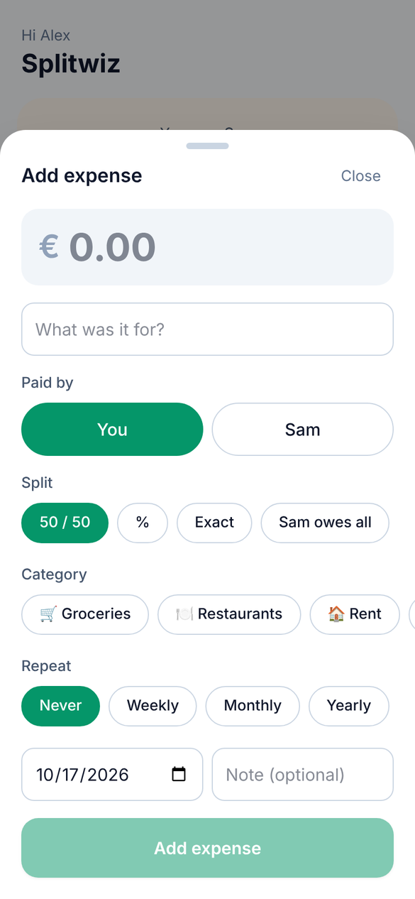
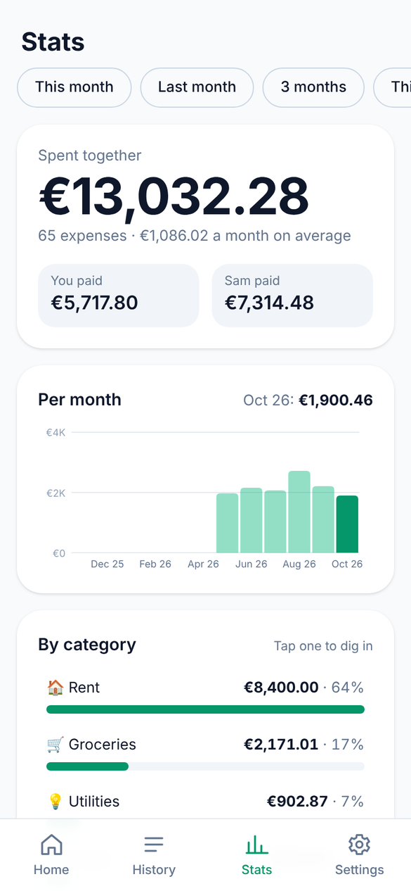
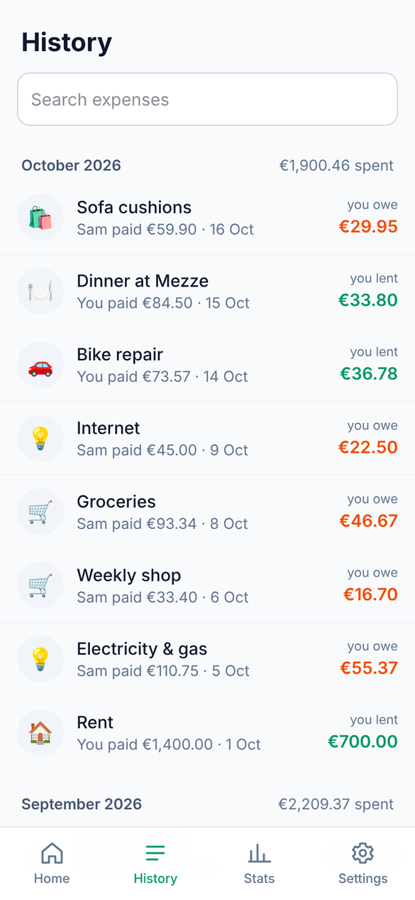

<div align="center">

# Splitwiz

**Split shared expenses with your partner or roommate, on a server you own.**

A small, self-hosted alternative to Splitwise for two people. No ads, no daily limits, no account on someone else's cloud. One Docker container, installable on your phone like a native app.

[](https://github.com/kalfasyan/splitwiz/actions/workflows/ci.yml)
[](LICENSE)
[](https://github.com/kalfasyan/splitwiz/pkgs/container/splitwiz)



</div>

## Why Splitwiz

- **Your data stays home.** Everything lives in one SQLite file on your own machine: a NAS, a home server, a Raspberry Pi-class box or a cheap VPS.
- **Fast to use.** Adding an expense is an amount, a description and one tap. The balance is the first thing you see.
- **Leaving Splitwise is easy.** Import a group's CSV export and you land on the same balance, with every expense and payment kept.
- **Tiny to run.** One container, about 30 MB of memory at rest, no external database.

## Features

- **Add an expense in a few taps**: amount, what it was for, who paid, and how to split it (50/50, percentage, exact amount, or "the other person owes all").
- **One balance** on the home screen: who owes whom, and how much.
- **Settle up** with one tap, in full or in part.
- **History** grouped by month, with search, edit and delete.
- **Repeating expenses** (weekly, monthly, yearly) are added automatically on their day, and caught up if the server was off. Any expense can be turned into a repeating one, and Settings suggests charges that already look monthly ("These look monthly"), for example right after an import.
- **Stats** for this month, last month, 3 or 12 months, this year or all time: total spent, who paid what, spending per month, a breakdown by category you can drill into, and the biggest expenses.
- **Category trend on every expense**: open an expense to see what you spent in its category over the last three months.
- **Import from Splitwise**: pick a group's CSV export under Settings. Importing the same file again only adds new rows.
- **Live sync** between both phones, **light and dark mode**, and a **CSV export** of everything.
- **Installable web app (PWA)** for Android and iOS, with its own home-screen icon.

<table>
  <tr>
    <td></td>
    <td></td>
    <td></td>
    <td></td>
  </tr>
</table>

## Quick start

You need Docker. This starts Splitwiz on port 8090 and keeps its data in `./pb_data`:

```sh
mkdir splitwiz && cd splitwiz
curl -O https://raw.githubusercontent.com/kalfasyan/splitwiz/main/docker-compose.yml
docker compose up -d
```

Then create the admin account and the two people who will use the app:

```sh
docker exec -it splitwiz /app/splitwiz superuser upsert you@example.com 'a-strong-password' --dir=/app/pb_data
```

1. Open `http://localhost:8090/_/` and sign in with that admin account.
2. Open the **users** collection and add two records (email, password, name). Sign-ups are closed, so these are the only two accounts.
3. Open `http://localhost:8090`, sign in as one of them, and start adding expenses.

Prefer plain `docker run`?

```sh
docker run -d --name splitwiz --restart always \
  -p 127.0.0.1:8090:8090 -v "$PWD/pb_data:/app/pb_data" -e TZ=Europe/Brussels \
  ghcr.io/kalfasyan/splitwiz:latest
```

Set `TZ` to your own time zone: it decides when repeating expenses are added and when the nightly backup runs.

## Using it from your phones

Phones need to reach Splitwiz over **HTTPS** to install it as an app. Put it behind any reverse proxy that handles certificates and forward to port 8090. With [Caddy](https://caddyserver.com), for example, this is the whole config:

```
splitwiz.example.com {
    reverse_proxy 127.0.0.1:8090
}
```

Nginx Proxy Manager, Traefik, a Cloudflare Tunnel or Tailscale work just as well. Then open the address on each phone, sign in, and choose **⋮ > Install app** in Chrome on Android or **Share > Add to Home Screen** (iOS/Safari).

### Step-by-step guides

- [Synology NAS (DSM 7, Container Manager)](docs/synology.md): container, free `*.synology.me` address, Let's Encrypt certificate and reverse proxy, all from the DSM interface.

## Updating

```sh
docker compose pull && docker compose up -d
```

Every push to `main` publishes a new `latest` image. Your data stays in `pb_data` and database migrations run on start.

## Backups

- Splitwiz makes a backup every evening at 20:00 (in your `TZ`) into `pb_data/backups` and keeps the last 7. You can change this in the admin page under Settings > Backups.
- Copy the `pb_data` folder somewhere else from time to time to keep a backup off the machine.
- Settings > Export all data (CSV) in the app gives you a human-readable copy.

## Good to know

- Splitwiz is built for **exactly two people** sharing costs, such as a couple or two roommates. It does not do groups.
- Amounts are shown in **euros** for now.
- The published image is for **x86-64** (`linux/amd64`). On ARM boards, build it yourself with `docker build -t splitwiz .`.

## How it is built

| Part | Choice |
| --- | --- |
| Backend | [PocketBase](https://pocketbase.io) used as a Go framework (`backend/`), SQLite database |
| Money logic | `backend/ledger`: integer cents, split, balance and repeat-date rules, unit tested |
| Splitwise import | `backend/splitwise`: parses the export and keeps each row's exact split |
| Web app | Svelte 5, Vite and Tailwind (`web/`), installable PWA |
| Packaging | One Docker image (`Dockerfile`), published to `ghcr.io/kalfasyan/splitwiz` by GitHub Actions |

The server computes what each person owes for every expense itself, so a phone can never store an inconsistent split.

## Development

```sh
# backend (needs Go 1.27+)
cd backend
go run . superuser upsert admin@example.com changeme123
go run . serve            # http://127.0.0.1:8090, admin at /_/

# web app with hot reload (needs Node 22+), in another terminal
cd web
npm install
npm run dev               # proxies /api to :8090
```

Tests: `cd backend && go test ./...` and `cd web && npm test && npm run check`.

`scripts/deploy-to-nas.sh user@host` builds the image on your computer and replaces the running container on a Synology NAS over SSH, for when you want to try a change before pushing it.

## Contributing

Issues and pull requests are welcome. Please run the tests above before opening a pull request; CI runs the same checks.

## License

[MIT](LICENSE)
